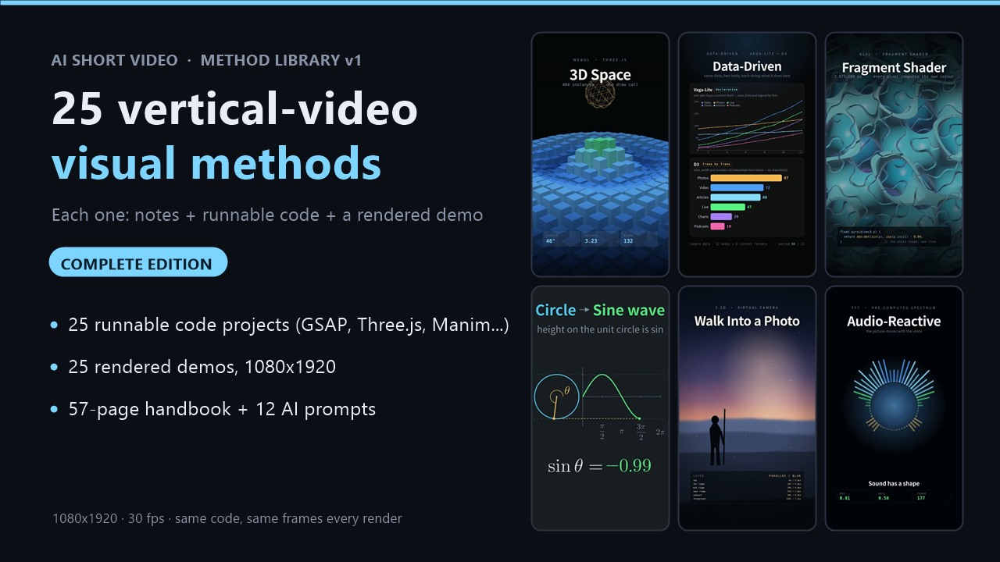

# AI Short Video Method Library

Three runnable MIT examples for producing vertical video with code, plus a catalog of 25 visual methods. Maintained by Nickwang Studio.

The public examples demonstrate GSAP timeline animation, Vega/D3 data graphics, and Mermaid diagrams. The remaining methods are described in the catalog; their full projects are in the separate paid edition.



## Run the free examples

Prerequisites: Node.js 18 or later and FFmpeg on your PATH. Chromium and JavaScript dependencies are installed by the setup command.

```bash
git clone https://github.com/Nickwang684/ai-short-video-method-library.git
cd ai-short-video-method-library
npm run setup
npm run render:gsap
npm run render:data
npm run render:diagram
```

Videos are written to `output/`. To render all three examples, run `npm run render:all`.

You can also run an individual example:

```bash
cd examples/m01-gsap-html
npm run render
```

Its output is `examples/m01-gsap-html/output/video.mp4`. The shared browser dependency must already be installed by the setup command.

On Linux, Chromium may also need system libraries. Playwright will report any missing libraries when you run an example. If you use an existing Chromium installation, consult the Playwright installation documentation for the supported configuration.

## How frame rendering works

Each browser scene exposes `SCENE_META` and `seekFrame(frame)`. The capture harness seeks a specific frame, takes a screenshot, and sends it to FFmpeg. It does not record the browser's real-time display.

```js
window.SCENE_META = {
  width: 1080, height: 1920,
  fps: 30, durationInFrames: 270
};
window.seekFrame = frame => timeline.time(frame / 30);
```

Repeatability depends on fixed inputs, fonts, assets, random seeds, and renderer versions. Live website and desktop recordings have different timing constraints. Check the exported duration and frame count before assembling a final video.

## Free examples in this repository

| Folder | What it demonstrates |
| --- | --- |
| `examples/m01-gsap-html` | Paused GSAP timeline, card stagger, and SVG drawing |
| `examples/m10-data-viz` | Data-driven Vega/D3 charts with frame-controlled animation |
| `examples/m16-diagram-as-code` | Mermaid text to SVG, animated nodes, and edge reveal |
| `examples/_shared` | Local file server, still capture, and frame-by-frame video capture |

The example `demo.mp4` files are rendered previews. You can inspect and modify the source without purchasing anything.

## Catalog of 25 visual methods

| ID | Method | Main tools | Public runnable example |
| --- | --- | --- | --- |
| m01 | Timeline typography and cards | GSAP, HTML, SVG | Yes |
| m02 | 3D product scenes | Three.js | Catalog |
| m03 | Procedural 3D scenes | Blender Python | Catalog |
| m04 | Math and formula animation | Manim | Catalog |
| m05 | Architecture and code animation | Motion Canvas | Catalog |
| m06 | Vector and icon motion | SVG, Lottie | Catalog |
| m07 | Filters, grading, and compositing | FFmpeg | Catalog |
| m08 | Synthetic product demonstrations | HTML | Catalog |
| m09 | Live browser workflow capture | Playwright | Catalog |
| m10 | Data graphics | Vega, D3 | Yes |
| m11 | 2.5D parallax | Layered images | Catalog |
| m12 | Geographic routes | MapLibre | Catalog |
| m13 | Kinetic text | Canvas | Catalog |
| m14 | Particle backgrounds | Canvas | Catalog |
| m15 | Shader motion | GLSL | Catalog |
| m16 | Diagrams as code | Mermaid, SVG | Yes |
| m17 | Terminal demonstrations | Terminal animation | Catalog |
| m18 | Physics scenes | Matter.js | Catalog |
| m19 | Audio visualizers | Audio analysis, Canvas | Catalog |
| m20 | Hand-drawn explainers | Rough.js | Catalog |
| m21 | Markdown slides to video | Marp | Catalog |
| m22 | Programmatic video templates | Revideo | Catalog |
| m23 | Desktop-window capture | Screen capture | Catalog |
| m24 | Silence detection and editing | FFmpeg | Catalog |
| m26 | Combined short-video timeline | Multiple methods | Catalog |

`m26` is the 25th method in the delivered catalog; `m25` is not a separate included project.

## Try the full library and send real feedback

I am inviting five developers to try the complete library for free. Open an issue with your operating system, your use case, and the method you want to run. After a real trial, share what worked, the exact step that failed, and one useful improvement. Positive reviews are not required.

Please do not post credentials or private data in an issue. General bug reports for the public examples are also welcome.

## Optional complete editions

The public repository remains usable on its own. Separate ready-made products contain all 25 method projects, rendered clips, and the handbook (PDF and editable DOCX).

- [Complete edition on Gumroad](https://nickster2735.gumroad.com/l/ai-video-methods-complete)
- [Handbook on Gumroad](https://nickster2735.gumroad.com/l/ai-video-methods-handbook)
- [Studio storefront](https://shop.nickwang.dpdns.org/ai-short-video-methods)

I maintain this repository and sell those separate editions. No custom editing or one-to-one service is included.

## License

Public example code is licensed under [MIT](LICENSE). Dependencies retain their own licenses. The paid package is a separate product with its own redistribution terms.
